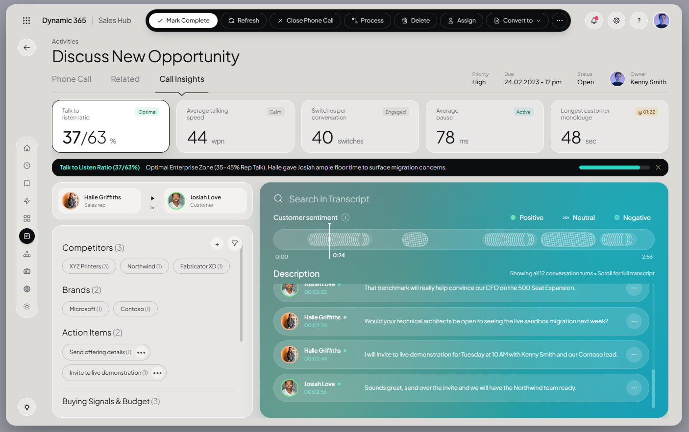

# Dynamic 365 | Sales Hub — Discuss New Opportunity

Template website frontend interaktif untuk **Microsoft Dynamics 365 Sales Hub (Call Intelligence & Activity Workspace)** berbasis HTML5, Tailwind CSS, dan Vanilla JavaScript. Dirancang sebagai static site tanpa proses build sehingga dapat langsung dijalankan secara lokal maupun dipublikasikan melalui **GitHub Pages** agar bisa diakses oleh siapa saja.



## Live Demo

Setelah di-push ke GitHub dan GitHub Pages aktif:

- **Repository:** `https://github.com/LALUARIFTA/dynamic_365_sales_hub_discuss_new_opportunity`
- **GitHub Pages:** `https://laluarifta.github.io/dynamic_365_sales_hub_discuss_new_opportunity/`

## Struktur Folder

```text
dynamic_365_sales_hub_discuss_new_opportunity/
├── .github/
│   └── workflows/
│       └── deploy.yml          # Workflow GitHub Actions untuk deploy otomatis ke GitHub Pages
├── assets/
│   ├── css/
│   │   └── styles.css          # Variabel tema, styling shell, gradient panel, dan animasi UI
│   ├── img/
│   │   ├── favicon.svg         # Ikon tab browser (SVG)
│   │   └── preview.png         # Screenshot preview aplikasi
│   └── js/
│       ├── data.js             # Data transkrip panggilan, KPI benchmark, dan konten 10 modul
│       └── main.js             # State global, Web Audio synth, filter transkrip, waveform & navigasi
├── .gitignore                  # Daftar file/folder yang diabaikan Git
├── .nojekyll                   # Menonaktifkan pemrosesan Jekyll di GitHub Pages
├── index.html                  # Entry point utama aplikasi frontend
└── README.md                   # Dokumentasi proyek
```

## Fitur Utama

- **10 Modul Navigasi Sidebar:** Executive Dashboard, Recent Activity, Pinned Records, AI Playbooks, Integrations, Activities (*Discuss New Opportunity*), Accounts & Contacts, Opportunity Pipeline Board, Quotes & CPQ Configurator, dan Conversation Intelligence Analytics.
- **Call Insights & Waveform Scrubber:** Timeline audio interaktif (`0:00` – `2:56`) dengan hover timestamp, pemutaran simulasi `1x / 1.5x / 2x`, serta efek audio cadence via Web Audio API.
- **Transcript Search & Smart Signals:** Pencarian transkrip real-time dengan highlight kata kunci, filter sentimen (*Positive*, *Neutral*, *Negative*), filter pembicara, serta deteksi kompetitor (*XYZ Printers*, *Northwind*, *Fabricator XD*).
- **KPI Benchmark Drawer:** 5 metrik percakapan (*Talk to listen ratio*, *Average talking speed*, *Switches*, *Average pause*, *Longest customer monologue*) lengkap dengan panel detail benchmark.
- **Interactive CRM Actions:** Ubah *Priority*, *Due Date*, *Owner*, *Business Process Flow*, tambah *Action Item*, kalkulator harga CPQ live, dan ekspor laporan panggilan (`.json`).
- **Keyboard Shortcuts:** `Space` untuk Play/Pause audio, serta `1` / `2` / `3` untuk berpindah antar tab (*Phone Call*, *Related*, *Call Insights*).

> **Catatan:** Template ini murni frontend/simulasi statis (seluruh data berada di `assets/js/data.js` tanpa backend atau database). Tailwind CSS dimuat melalui CDN dan foto avatar berasal dari Unsplash, sehingga memerlukan koneksi internet saat dibuka.

## Cara Menjalankan Secara Lokal

Karena seluruh aset bersifat statis, Anda dapat membukanya dengan salah satu cara berikut:

1. **Buka langsung** file `index.html` di browser, atau
2. **Jalankan local HTTP server** (disarankan):

   ```bash
   # Menggunakan Python
   python -m http.server 8080

   # Atau menggunakan Node.js
   npx serve .
   ```

   Lalu buka `http://localhost:8080` di browser.

## Cara Publish ke GitHub Pages

1. Push proyek ini ke repository GitHub Anda (`main` branch).
2. Buka **Settings → Pages** di repository GitHub.
3. Pada **Source**, pilih **GitHub Actions** (workflow `.github/workflows/deploy.yml` sudah tersedia) atau pilih **Deploy from a branch** (`main` / `root`).
4. Tunggu proses deploy selesai, lalu situs dapat diakses secara publik oleh semua orang.
